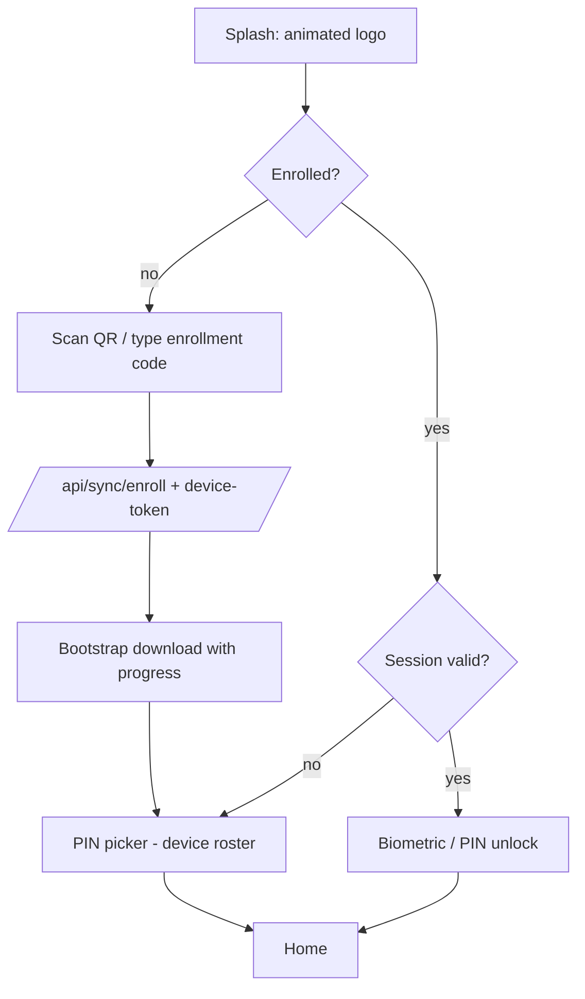
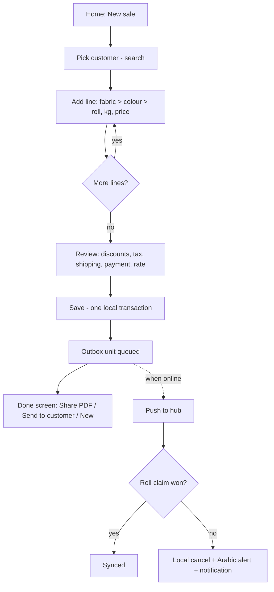

# PRD — Motard ERP Mobile (Android v1)

| Field    | Value                                                                                                       |
| -------- | ----------------------------------------------------------------------------------------------------------- |
| Product  | Motard ERP Mobile (`mobile/`, branch `feat/mobile`)                                                         |
| Owner    | yamanlazein                                                                                                 |
| Status   | Draft 0.1 — for review before Spec-kit                                                                      |
| Date     | 2026-10-24                                                                                                  |
| Baseline | Desktop 3.0.7 (SQLite engine), sync hub on Render (PostgreSQL)                                              |
| Sources  | Project brain (`Brain/Project/Motard ERP`), targeted code lookups, owner interview (21 answers, Appendix A) |

---

## 1. Executive summary

Motard ERP is an Arabic (RTL) ERP for fabric traders: invoices, returns, receipts and payments, cashbox, double-entry ledger, inventory (fabric → colour → roll), stock counts, statements and multi-device sync. It ships today as a website and an offline-first Windows desktop app that syncs through a hub.

This PRD defines **Motard ERP Mobile v1**, an **Android** app (iOS later, from the same code) that:

- is a **full sync device**, the same as a desktop: local SQLite database, works fully offline, pushes and pulls through the **existing** hub protocol (outbox/inbox, number blocks, claims);
- runs the **same business logic** (same use-cases, the same money math from `@erp/shared`), so a document made on a phone is identical to one made on the desktop;
- keeps the desktop's daily features and drops screens that make no sense on a phone (system settings, year closing, raw ledger, print center/press, sync-conflict admin);
- has a **new phone-first UI**: the same brand identity but cleaner, larger and clearer than the desktop. It is not a shrunk desktop.

Stack: **React Native + Expo (dev build), TypeScript**. That stack is chosen so the TypeScript sync and accounting code can be reused, not rewritten.

## 2. Problem statement and background

### 2.1 Problem

- Everyone in the shop (owner, accountant, warehouse, viewer) has to be at the desktop to see a balance, collect a payment, issue an invoice or check stock.
- The website needs a connection, and Syrian connectivity is unreliable. Only the desktop works offline today.
- The desktop UI has grown patched areas (for example, the 1,593-line entry-invoice screen creates colours and rolls client-side before posting, which can leave orphan records). Copying it would carry those problems to phones.

### 2.2 What exists (reuse, do not reinvent)

| Asset                                                                                                                        | Where                                                                   | Reuse on mobile                       |
| ---------------------------------------------------------------------------------------------------------------------------- | ----------------------------------------------------------------------- | ------------------------------------- |
| Domain + money math, Zod schemas                                                                                             | `packages/shared` (`@erp/shared`, `precision.ts` `round2dp`/`round4dp`) | Import directly                       |
| Use-cases (invoices, vouchers, returns, cashbox, inventory, parties, orders, expenses, statements, dashboard, profit, sync…) | `backend/src/application/use-cases/*`                                   | Run in-process on the phone (see §10) |
| SQLite repositories (47) + migrations (10) + schema fingerprint                                                              | `backend/src/infrastructure/repositories/sqlite`, `orm/sqlite`          | Run on the phone's SQLite             |
| Sync client (enqueue, push lanes, pull cursor, number blocks, claims, rebase on hub epoch)                                   | `backend/src/application/use-cases/sync/*` (~9,000 lines)               | Same protocol, same code              |
| Hub API                                                                                                                      | `/api/sync/*`, `/api/auth/*` on Render                                  | Unchanged contract                    |

## 3. Goals, non-goals

### 3.1 Goals

| ID  | Goal                                                      | Measure (see §15)                                                                                  |
| --- | --------------------------------------------------------- | -------------------------------------------------------------------------------------------------- |
| G1  | Do daily shop work from a phone with no connection        | 100% of v1 write flows work in airplane mode                                                       |
| G2  | Zero accounting divergence between phone, desktop and hub | 0 mismatches on the shared money test vectors and on the sync parity suite                         |
| G3  | Faster than walking to the desktop                        | Median time to record a receipt ≤ 20 s; a sale invoice with 3 lines ≤ 60 s                         |
| G4  | Clear on any phone size                                   | Usable from 360 dp to 480 dp width (and tablets) with no horizontal scroll and 48 dp touch targets |
| G5  | Safe if a phone is lost                                   | Admin revokes it; local data is wiped on its next contact; the database is encrypted at rest       |

### 3.2 Non-goals (v1)

- iOS release (the code must stay iOS-compatible; only Android is shipped and tested).
- Barcode or QR scanning of rolls (owner: not wanted). QR is used only for device enrollment.
- Push notifications from a server (Firebase). v1 uses local notifications only.
- LAN or direct desktop-to-phone sync. The phone talks to the hub only.
- WhatsApp Business API or automatic sending. The user always presses Send.
- English UI. v1 is Arabic only.
- New accounting rules. Every open owner decision in the brain's `Open Issues` stays as the desktop has it.

## 4. Users, personas and roles

All roles use the app equally (owner answer). Roles and their offline rights are **the same as the desktop**:

| Role         | Online                                       | Offline on the phone | Notes                                                                  |
| ------------ | -------------------------------------------- | -------------------- | ---------------------------------------------------------------------- |
| `admin`      | Full                                         | Write                | Only role that grants admin, edits admin accounts, **revokes devices** |
| `accountant` | Full admin privileges (`hasAdminPrivileges`) | Write                |                                                                        |
| `warehouse`  | Per desktop rules                            | Read only            |                                                                        |
| `viewer`     | Read                                         | Read only            |                                                                        |

Personas:

- **Owner in the market**: checks today's cash and a customer's balance, takes a payment, and sends the statement on WhatsApp.
- **Accountant away from the desk**: records receipts, payments and expenses, issues sale invoices and returns, checks profit.
- **Warehouse staff**: looks up fabric, colour and roll stock and roll movement history (reads offline, writes online per the role rules).
- **Viewer**: read-only dashboards and statements.

Scale: **more than 5 phones per shop** (owner answer). This drives numbering, §6.10.

## 5. Scope (MoSCoW)

### Must (v1)

- Splash (animated company logo) → login (PIN picker, same as the desktop) → **one-year persistent session** → biometric/PIN **app lock**.
- Device enrollment by an enrollment code from the desktop (QR scan or typed), then the first full download (bootstrap).
- Home: today's summary (cashbox USD/SYP, today's sales, receivables/payables, sync state) plus quick actions.
- Customers and suppliers: search, list, detail, create/edit, **statement** (full, paged to the end), balance.
- Sale invoice: create, view, cancel.
- Entry (purchase) invoice: create, view, cancel. This is a redesigned flow (§9.4).
- Returns: sale return and entry return (create, view, cancel).
- Receipts and payments: create, view, cancel, **amend through `replace`** (one transaction).
- Expenses: create, view, cancel.
- Cashbox: state, day movements, balance by date, manual movements.
- Inventory: fabrics → colours → rolls browse and search, roll movement history, roll adjustment, stock count.
- Orders: create, view, cancel, fulfil.
- Reports: summary, party balances, detail reports, profit summary and details (read).
- Share an invoice, receipt or statement as a **PDF** through the Android share sheet.
- **"Send to customer"**: opens WhatsApp on the customer's saved number with the PDF and a typed note; the user presses Send.
- Full offline operation and the background/foreground sync loop, with a visible sync state.
- Local notifications: a document rejected by the hub, sync stopped (dead/unknown device/version gate), low stock after sync.
- Remote revoke plus local wipe.
- Distribution as a **direct signed APK and on Google Play**, with the same signing identity.

### Should

- Party opening balances (create/edit) — an accounting action, so admin/accountant only.
- Cashbox close-day (sends only `date/counted/currency`; the server derives the rest).
- Desktop shows the enrollment code as a QR (a small desktop change).
- Dark theme that follows the system setting (the desktop already has dark styles).
- Revoke screen on the desktop shows the phone's unsynced unit count before wiping.

### Could

- Home-screen widget (today's cash).
- Saved WhatsApp note templates.
- Tablet two-pane layouts.

### Won't (v1; they stay on the desktop)

- System settings: backup, Google Drive, printing, units, warehouses, invoice settings, users, payment methods, company profile edit.
- Year closing and the raw ledger screen.
- Print center and press (print-send / print-receive) invoices.
- Sync conflicts resolution screen and the activity/audit log (the phone shows an alert and a "resolve on desktop" message only).
- Backup/restore, Smart Merge, Phenix import, licence admin, party merge, dye purge.

## 6. Functional requirements

IDs are stable for Spec-kit. "Same as desktop" means the identical use-case and validation runs on the phone.

### 6.1 Launch, session, lock

- **FR-01** Animated logo splash ≤ 1.5 s, which also covers database open and migration.
- **FR-02** First run on an enrolled device: the PIN picker lists the device's users (`/api/auth/device-roster`), then PIN login (`/api/auth/pin-login`). Password login (`/api/auth/login`) is the fallback.
- **FR-03** The session is permanent, as on the desktop (tokens last a year, no idle logout). It ends only on logout, a refused refresh (401/403 on `/api/auth/refresh`), revocation, or a wipe. A 403 on any other call is **not** a session end.
- **FR-04** App lock: after 60 s in the background, or on cold start, unlock with biometrics, falling back to the PIN. This is separate from the session.
- **FR-05** Offline login: if the last online login is cached, the PIN works offline against a locally stored verifier (same Argon2id parameters as the desktop's local verifier). Offline rights follow §4.

### 6.2 Enrollment and bootstrap

- **FR-06** The admin creates an enrollment code on the desktop (`/sync/hub/enrollment-code`) and shows it as text or QR. The phone scans or types it and calls `/api/sync/enroll`, then `/api/sync/device-token`, and stores the device credential in the Android Keystore.
- **FR-07** Bootstrap: download the tenant snapshot (`/sync/bootstrap`, `/sync/snapshot-watermark`), then pull to the tip. Progress shows as a percentage plus a document count. It can be resumed after interruption.
- **FR-08** The tenant id comes from enrollment and never changes on that device. A re-install means re-enrolment with a new sync identity (same rule as a restored desktop).

### 6.3 Home

- **FR-09** Cards: cashbox balance per currency (USD and SYP never mixed), today's sales, total receivables and payables, pending sync count and last successful sync time. Data comes from the local `dashboard` use-case.
- **FR-10** Quick actions (by role): new sale invoice, receipt, payment, expense, find party.

### 6.4 Parties

- **FR-11** Search customers and suppliers locally (same matching as `/parties/search`), sorted by recent use.
- **FR-12** Party detail: balance per currency, contact (phone used by FR-30), recent documents, statement.
- **FR-13** Statement: the same order (`date, created_at, document-rank, id`) and the same running balance from the use-case. Pages of 200, followed to the end (as in fix F18).
- **FR-14** Create/edit a party. Names are unique per tenant (`UNIQUE(tenant_id, name)`); a duplicate shows the desktop's Arabic message.

### 6.5 Sales, purchases, returns

- **FR-15** Sale invoice: pick a customer → add lines (fabric → colour → roll; kg, pieces 0 allowed, price, fixed-amount line discount) → header discount/tax/shipping as fixed amounts → optional payment. The server-side total formula runs locally; the UI only displays it. One local transaction: number + header + lines + ledger + voucher + cashbox.
- **FR-16** Entry invoice: supplier → lines. New colours and rolls are created **inside the same use-case transaction**, not client-side first (fixes the desktop's orphan risk; §9.4).
- **FR-17** Cancel writes reversals, never edits (the ledger is append-only).
- **FR-18** Returns (sale and entry): pick the source invoice and its lines. Valuation follows the desktop (unweighted AVG price per roll at the invoice's frozen FX rate). Weight-only (0 pieces) is allowed.
- **FR-19** Exchange rate: the user enters SYP per 1 USD (the reference from `/fx/reference-rate` is used when the phone is online and cached). The rate is frozen on the document.

### 6.6 Vouchers, expenses, cashbox

- **FR-20** Receipt or payment: party, amount (the cash that actually moves), currency, rate, optional write-off (`discount`), optional settlement of invoices. A negative cash balance is allowed **with a warning**.
- **FR-21** Amending a voucher uses `replace` (cancel + create in one transaction), never two operations.
- **FR-22** Expenses: name (autocomplete from `/expenses/names`), amount, currency; cancel.
- **FR-23** Cashbox: state, movements by day, balance at a date, manual movements. A day that is locked or a year that is closed refuses writes with the desktop's message.

### 6.7 Inventory and orders

- **FR-24** Browse and search fabrics → colours → rolls with remaining kg. Low-stock badge based on `minStockKg`.
- **FR-25** Roll detail: movements; adjustment (`/inventory/rolls/:id/adjust`) for allowed roles; price edit only before any sale (COGS is frozen).
- **FR-26** Stock count: a count sheet on the phone, entered per roll, posted as adjustment movements, following the desktop count flow.
- **FR-27** Orders: create, view, cancel, fulfil. Pending conflicts are shown read-only.

### 6.8 Reports

- **FR-28** Summary, party balances, detail reports by slug, profit summary and details. All local, read-only, filtered by date range. Profit uses COGS from the snapshot taken at sale.

### 6.9 Sharing

- **FR-29** PDF of an invoice, return, voucher or statement, rendered from the same HTML print layouts as the desktop (Arabic font embedded), and shared through the Android share sheet.
- **FR-30** "Send to customer": uses the party's saved number (or one typed in), plus an editable note, and opens WhatsApp on that chat with the PDF attached and the note as text. If attaching to a specific chat isn't possible on the device, it falls back to `wa.me/<number>?text=<note>` followed by the share sheet for the file. Nothing is sent automatically.

### 6.10 Sync

- **FR-31** Every write enqueues sync units through the same `syncEnqueue` path, with a durable `op_id`.
- **FR-32** The sync loop runs on app start, on foreground, on network regain, after each write (debounced), and every 20 s while foregrounded. It retries after 30 s and 2 min, and drains in 50-unit batches. In the background it relies on Android WorkManager (best effort, at least every 15 min).
- **FR-33** Push lanes are the same as the desktop's: lane 0 for masters/ledger/cashbox/settings, lanes 1–3 hashed by document.
- **FR-34** Claims use the same rule as the desktop: first write to reach the hub wins. The loser's document is cancelled locally, and the user gets a clear Arabic alert and notification naming the document and the roll.
- **FR-35** Number blocks: phones claim **smaller blocks** (invoice 100, others 50) so that more than 5 devices don't burn numbering. The hub already accepts `size` on `/sync/number-blocks/claim`; the device side currently always uses `defaultBlockSize` — a small change keyed to the device kind. If a phone runs out of block numbers while offline, it falls back to the existing fallback numbering with `knownUsed` reporting.
- **FR-36** Hub epoch change → rebase (reset cursor, re-queue delivered history, re-report tips), same as the desktop.
- **FR-37** A sync status screen (read-only) shows: pending count, last run, last error, rejected/dead documents with the message "يجب الحل من الديسكتوب" (must be resolved on the desktop). There is no requeue button (same design as the desktop).
- **FR-38** Version gate: the phone sends its app version and the hub refuses sync from a build whose rounding/schema version differs (the hub and all devices must run the same version). The phone shows "تحديث مطلوب" (update required) with a download link. _To verify: whether the hub already enforces this; if not, add it as a hub change._

### 6.11 Security

- **FR-39** The local database is encrypted at rest (SQLCipher). Its key is kept in the Android Keystore.
- **FR-40** Remote revoke: the admin revokes the phone on the desktop (`POST /sync/devices/:deviceId/revoke`). When the phone next learns it is revoked (push/pull/token refusal with the revoked reason), it wipes the database, keys and cached PDFs and returns to the enrollment screen.
- **FR-41** Screenshots are allowed (needed for sharing), but the app content is hidden in the recent-apps view.

### 6.12 Updates and distribution

- **FR-42** Two channels: Google Play and a direct signed APK (download link). Both use the **same app signing key** (an owner-provided key registered with Play App Signing), so a user can move between channels without uninstalling and losing data.
- **FR-43** In-app update check (direct APK channel): compares against a version manifest on the hub and offers the download. Sync is refused until the update (FR-38).

## 7. Non-functional requirements

| ID     | Area          | Requirement                                                                                                                                              |
| ------ | ------------- | -------------------------------------------------------------------------------------------------------------------------------------------------------- |
| NFR-01 | Performance   | Cold start to an unlocked home screen ≤ 2.5 s on a mid-range Android (4 GB RAM, Android 10+) with 100k documents                                         |
| NFR-02 | Performance   | Party search ≤ 150 ms; statement first page ≤ 500 ms; invoice save ≤ 300 ms (local)                                                                      |
| NFR-03 | Capacity      | Full tenant data on the phone (owner answer); proven at 10k / 50k / 100k documents, as the desktop scale audit did                                       |
| NFR-04 | Offline       | All Must flows except enrollment/bootstrap work with no network indefinitely; tokens last 1 year                                                         |
| NFR-05 | Correctness   | Money via `round2dp`/`round4dp` only; storage as scaled integers like the desktop's SQLite engine; identical results to PG `ROUND` (half away from zero) |
| NFR-06 | Durability    | WAL mode; each document is one transaction; the outbox survives app kill, OS kill and update                                                             |
| NFR-07 | Compatibility | Android 8.0 (API 26)+ supported, Android 10+ targeted for performance; 360–480 dp phones, tablets usable                                                 |
| NFR-08 | Size          | APK ≤ 60 MB                                                                                                                                              |
| NFR-09 | Accessibility | Touch targets ≥ 48 dp; body text ≥ 16 sp; contrast WCAG AA; respects system font scale up to 130% without clipping                                       |
| NFR-10 | Localization  | Arabic only, full RTL; Western Arabic digits by default (same as the desktop), money formatted per currency                                              |
| NFR-11 | Reliability   | Crash-free sessions ≥ 99.5%                                                                                                                              |
| NFR-12 | Privacy       | No analytics or crash SDK in v1 unless approved (the desktop build ships with Sentry off)                                                                |
| NFR-13 | Battery       | Background sync ≤ 2% battery/day at typical use                                                                                                          |

## 8. User flows

### 8.1 First run



### 8.2 Sale invoice (offline)



### 8.3 Receipt and send to customer

Home → Receipt → customer → amount, currency, rate (optional write-off) → Save → Done → "Send to customer" → note → WhatsApp opens on the chat with the PDF → the user presses Send.

### 8.4 Lost phone

Desktop: Settings → Sync → Devices → Revoke (shows the phone's unsynced count, Should) → hub marks it revoked → the phone's next contact is refused as revoked → wipe → enrollment screen.

### 8.5 Update required

Sync refused for version → banner "تحديث مطلوب" (update required) → Play or APK download → after the update the pending outbox drains.

## 9. UX/UI requirements

### 9.1 Principles

1. **Phone-first, not desktop-shrunk.** One task per screen, the primary action fixed at the bottom within thumb reach, no tables wider than the screen (rows become cards).
2. **Same identity, clearer.** Logo, brand colours and font from the desktop (`src/styles.css` tokens), with bigger type, more spacing and fewer elements on each screen.
3. **Money is unmistakable.** The currency label is shown on every amount, USD and SYP are never summed, and a negative balance has both a colour and a sign.
4. **Offline is normal.** A small sync chip on every screen (synced / pending N / offline / attention). There are no blocking spinners for local work.
5. **Arabic first.** RTL layout and mirrored icons, Arabic copy reused from the desktop where it is correct, and no mixed-language labels.

### 9.2 Navigation

Bottom tab bar (RTL order): **الرئيسية** (Home) · **الزبائن والموردين** (Customers & suppliers) · **إضافة** (Add: a centre action sheet with sale, purchase, receipt, payment, expense, return, order) · **المخزون** (Inventory) · **المزيد** (More: reports, cashbox, orders, sync status, profile/logout). Items are filtered by role.

### 9.3 Components

- One form-field component tied to its label (the desktop's `FormField` rule).
- Numeric keypad for amounts and kg. Thousands separators while typing.
- Bottom-sheet pickers with search for party/fabric/colour/roll.
- Feedback uses a success toast for success and an error toast for errors (the desktop rule).
- Skeleton loading; empty states with one clear action.

### 9.4 Desktop mistakes not to copy

- Entry invoice creating colours and rolls before posting → on mobile, everything is created in one use-case transaction.
- Giant multi-purpose screens → split into steps (party → lines → review).
- Settings sprawl → none on mobile except profile, lock and sync status.
- A historical name issue (old documents show the party's current name) is a known open issue; mobile shows what the data holds and does not try to fix it.

### 9.5 Screen sizes

Layout based on breakpoints (compact < 400 dp, regular 400–599 dp, tablet ≥ 600 dp). The safe area is respected, and the layout adapts when the keyboard opens so the primary action stays visible.

## 10. Technical architecture

### 10.1 Stack

| Layer                 | Choice                                                                                                                                                                     | Why                                                                                                                 |
| --------------------- | -------------------------------------------------------------------------------------------------------------------------------------------------------------------------- | ------------------------------------------------------------------------------------------------------------------- |
| App                   | React Native + **Expo dev build** (prebuild, not Expo Go), TypeScript                                                                                                      | Reuses the TS domain, use-cases and sync code; one codebase for iOS later                                           |
| Navigation            | Expo Router                                                                                                                                                                | File routes, similar to the TanStack mental model                                                                   |
| Data fetching / cache | React Query (same as web) calling **local** use-cases                                                                                                                      | Same invalidation habits (`invalidateFinancialViews`)                                                               |
| DB                    | SQLite with **SQLCipher**, via a driver that supports synchronous calls, user-defined functions and custom aggregates (candidate: `op-sqlite`; must be proven in spike S1) | The SQLite repos rely on `motard_pgdiv`, `motard_dectext`, `motard_decsum`, `motard_re_*` and safe-integer handling |
| ORM                   | Drizzle (same schema as `orm/sqlite/schemas`)                                                                                                                              | Shared schema + fingerprint gate                                                                                    |
| PDF                   | `expo-print` (HTML → PDF) + `expo-sharing`                                                                                                                                 | Reuse the desktop's print HTML                                                                                      |
| Secure storage        | Android Keystore (`expo-secure-store`)                                                                                                                                     | Device credential, DB key, tokens                                                                                   |
| Biometrics            | `expo-local-authentication`                                                                                                                                                | FR-04                                                                                                               |
| Background            | WorkManager (`expo-background-task`)                                                                                                                                       | FR-32                                                                                                               |
| Notifications         | `expo-notifications` (local only)                                                                                                                                          | §5                                                                                                                  |

### 10.2 Code sharing plan (recommended)

Extract the platform-neutral parts of `backend/` into **`packages/core`**: use-cases, ports, SQLite repositories, the sync client, number blocks and the clock/sequence helpers. Both the desktop backend and the mobile app consume it through a small DB adapter (`better-sqlite3` on the desktop, the mobile driver on the phone). Do this incrementally: each moved module must keep the desktop SQLite suite (1136 tests) green, and the twin rule with `Postgres*` repos still applies.

_Alternative if extraction is too risky before release:_ `mobile/` imports from `backend/src` through path aliases (no moves), with a lint boundary that bans Express, `pg` and Node built-ins in anything the phone imports. The choice is made in the Spec phase (open question Q1).

### 10.3 Runtime picture

```
UI (RN screens) → hooks (React Query) → core use-cases → Sqlite* repos → encrypted SQLite
                                         ↘ syncEnqueue → sync_outbox → sync client ⇄ Hub /api/sync/*
```

There is no Express server and no HTTP inside the phone. Use-cases are called directly. The tenant context is fixed (one tenant per device), as on the desktop SQLite engine (no RLS locally).

### 10.4 Repository layout

```
mobile/            Expo app (app/, components/, theme/, platform adapters)
packages/shared/   unchanged
packages/core/     (if Q1 = extract) use-cases, sqlite repos, sync client
```

Mobile CI job: typecheck, lint (0 warnings), unit tests, the shared money vectors and the sync parity suite run against a disposable hub.

## 11. API specification (mapped to the existing backend)

### 11.1 Hub endpoints the phone calls over the network (unchanged contract)

| Purpose                      | Endpoint                                                                                                    |
| ---------------------------- | ----------------------------------------------------------------------------------------------------------- |
| Enroll device                | `POST /api/sync/enroll`, `POST /api/sync/device-token`                                                      |
| Register device / credential | `POST /api/auth/sync-device`, `/sync/devices/self/credential`                                               |
| Users on device / login      | `GET /api/auth/device-roster`, `POST /api/auth/pin-login`, `POST /api/auth/login`, `POST /api/auth/set-pin` |
| Session                      | `POST /api/auth/refresh`, `POST /api/auth/logout`, `GET /api/auth/me`                                       |
| Bootstrap                    | `GET /sync/bootstrap`, `GET /sync/snapshot-watermark`                                                       |
| Sync                         | `POST /sync/push`, `POST /sync/pull` (cursor `applied_seq`)                                                 |
| Number blocks                | `POST /sync/number-blocks/claim` (with `size`), `/ensure`, `/tip`, `/reclaim`, `GET /sync/number-blocks`    |
| Health                       | `GET /sync/status`, `GET /sync/pending`, `GET /sync/inbox?status=rejected,dead`                             |
| FX reference                 | `GET /fx/reference-rate`                                                                                    |
| Revoke (desktop/admin side)  | `POST /sync/devices/:deviceId/revoke`, `/reinstate`                                                         |

Every financial operation keeps the **`Idempotency-Key` / `op_id`** guarantees: sync units carry durable `op_id`s, so re-sending cannot duplicate.

### 11.2 Business operations: local use-case calls (parity map)

The phone calls the same use-case each desktop route calls. The endpoint column is the desktop contract that the parity tests compare against.

| Mobile feature               | Desktop endpoint (same use-case)                                                                                                                  |
| ---------------------------- | ------------------------------------------------------------------------------------------------------------------------------------------------- |
| Sale/entry invoice           | `POST /invoices`, `GET /invoices/:id`, `POST /invoices/:id/cancel`, `GET /invoices/next-number`                                                   |
| Returns                      | `POST /returns`, `GET /returns/:id`, `POST /returns/:id/cancel`                                                                                   |
| Receipts/payments            | `POST /receipts`, `/payments`, `/:id/cancel`, `/:id/replace`, `GET /vouchers/:id`                                                                 |
| Expenses                     | `POST /expenses`, `/:id/cancel`, `GET /expenses/names`                                                                                            |
| Cashbox                      | `GET /cashbox/state`, `/movements/:date`, `/balance/:date`, `/locked/:date`, `POST /cashbox/manual-movements`, `POST /cashbox/close-day` (Should) |
| Parties                      | `GET/POST /customers`, `/suppliers`, `/:id`, `/:id/opening` (Should), `GET /parties/search`                                                       |
| Statements                   | statement route `/customers`, `/suppliers` (cursor paging)                                                                                        |
| Inventory                    | `/inventory/fabrics`, `/colors`, `/rolls`, `/rolls/:id/adjust`, `/rolls/:id/movements`, `GET /fabrics/search`, `/colors/search`, `/rolls/search`  |
| Stock count                  | `/financial-years/count-sheet`, `/counts`, `/counts/post` (count part only, not closing)                                                          |
| Orders                       | `/orders`, `/:id`, `/:id/cancel`, `/:id/fulfill`, `/orders/by-code`, `/orders/pending-conflicts`                                                  |
| Dashboard / reports / profit | `GET /dashboard`, `/reports/summary`, `/reports/party-balances`, `/reports/detail/:slug`, `/profit/summary`, `/profit/details`                    |
| Notifications                | `GET /notifications` (local)                                                                                                                      |

### 11.3 Backend changes the mobile app needs

| ID   | Change                                                                                                      | Size |
| ---- | ----------------------------------------------------------------------------------------------------------- | ---- |
| BC-1 | Device-side block size per device kind (phone: invoice 100, others 50)                                      | S    |
| BC-2 | Version gate on push/pull, if not already present (FR-38)                                                   | S–M  |
| BC-3 | Revoked state returned with a distinct reason code that the phone can act on (verify existing refusal text) | S    |
| BC-4 | Desktop: enrollment code shown as QR (Should)                                                               | S    |
| BC-5 | Version manifest endpoint for the APK channel (FR-43)                                                       | S    |
| BC-6 | `packages/core` extraction (if Q1 = extract)                                                                | L    |

## 12. Data model (existing system, unchanged)

The phone uses the **same SQLite schema, migrations and fingerprint** as the desktop. No new business tables.

| Domain    | Tables                                                                                                                                                                           |
| --------- | -------------------------------------------------------------------------------------------------------------------------------------------------------------------------------- |
| Parties   | `parties` (customers/suppliers, `UNIQUE(tenant_id,name)`)                                                                                                                        |
| Inventory | `fabrics`, `colors`, `rolls` (`color_id` NOT NULL, `remaining_kg ≥ 0`, `price_per_kg`, `supplier_id` nullable, `entry_source`), `stock_movements`, `inventory_counts`            |
| Documents | `invoices` (+`invoice_lines`, `roll_id` NOT NULL, `cost_per_kg` snapshot), `returns` (+`return_lines`), `orders` (+`order_items`), `expenses`, `print_jobs` (not used on mobile) |
| Money     | `ledger_entries` (append-only trigger, ~20 types), `ledger_entry_archive`, `cashbox` / daily balance series (trigger-maintained), manual movements, `financial_years`            |
| Numbering | `document_number_blocks`, `document_sequences`, `motard_sequences`                                                                                                               |
| Sync      | `sync_outbox`, `sync_inbox` (`applied_seq`), `sync_resource_claims`, `sync_devices`, `sync_device_authorized_users`, `device_registrations`                                      |
| Auth      | `users`, `revoked_tokens`, `idempotency_keys` / `financial_operations`                                                                                                           |
| Misc      | `settings`, `company_profile`, `notifications`, `audit_log`, `motard_meta`, `motard_tx_state`                                                                                    |

Mobile-only local state (app lock flag, last sync time, update channel) goes in the existing `motard_meta` key-value table or in secure storage. Desktop-only tables (Drive archive, backup) are created by the shared migrations but never written on the phone.

Invariants that must hold on the phone: money stored as scaled integers; the ledger is append-only (a cancel writes reversals); FX rate frozen per document; statement ordering; one tenant per device.

## 13. Edge cases and error handling

| #   | Case                                                   | Behaviour                                                                                                                                                                                  |
| --- | ------------------------------------------------------ | ------------------------------------------------------------------------------------------------------------------------------------------------------------------------------------------ |
| E1  | Two devices sell the same roll offline                 | First to reach the hub wins. The loser is cancelled locally, with an Arabic alert and a notification (FR-34)                                                                               |
| E2  | Phone uses up its number block offline                 | Fallback numbering, reported through `knownUsed`, no overlap (existing design)                                                                                                             |
| E3  | Phone offline for weeks                                | Works. Tokens last 1 year. On reconnect the backlog drains in 50-unit batches with progress                                                                                                |
| E4  | Hub epoch changed (hub migrated)                       | Automatic rebase (FR-36)                                                                                                                                                                   |
| E5  | Document `dead` after 5 attempts                       | Shown in sync status with "resolve on desktop"; no requeue                                                                                                                                 |
| E6  | App killed mid-save                                    | The transaction rolls back; nothing half-written; the outbox is consistent                                                                                                                 |
| E7  | Phone revoked while it has unsynced data               | Wipe proceeds (lost-device policy). The desktop shows the unsynced count before revoking (Should)                                                                                          |
| E8  | Re-install / new phone                                 | Re-enrol, new sync identity, bootstrap. Old unsynced data on an uninstalled app is lost (warned at uninstall time is impossible on Android → warn in the app when there are pending units) |
| E9  | Version mismatch with hub                              | Sync refused until updated; local work continues                                                                                                                                           |
| E10 | Day locked / year closed (done on the desktop, pulled) | Writes for that date are refused with the desktop's message                                                                                                                                |
| E11 | Negative cash after a payment                          | Allowed with a warning                                                                                                                                                                     |
| E12 | Duplicate party name                                   | Refused with the desktop's message; suggest the `name — city` convention                                                                                                                   |
| E13 | Party has no phone for WhatsApp                        | Prompt for a number (optionally saved to the party)                                                                                                                                        |
| E14 | WhatsApp not installed / chat attach unsupported       | Fallback to the `wa.me` link + share sheet, or share sheet only                                                                                                                            |
| E15 | Low storage on the phone                               | Pre-check before bootstrap (estimated size); clear error; cached PDFs are pruned first                                                                                                     |
| E16 | Clock wrong on the phone                               | Documents use the tx clock (`motard_tx_state`). Show a warning when the device time differs from the hub's by more than 5 min                                                              |
| E17 | Writes made on the hub web UI                          | Not in the pull stream (a known gap shared with the desktop); documented, not fixed in v1                                                                                                  |
| E18 | User role changed while offline                        | Applied on the next pull; offline writes already made are judged by the hub at materialization                                                                                             |

## 14. Security and privacy

- SQLCipher database; key in the Keystore; tokens and device credential in secure storage.
- No secrets in the APK. The hub URL is per tenant from enrollment.
- JWT HS256 with `jti`; refresh-only session end, as on the desktop.
- Remote revoke and wipe (FR-40). App hidden in recent apps (FR-41).
- APK signed with the owner's key. The same key is registered with Play App Signing (FR-42). The key is backed up offline by the owner.
- No telemetry in v1 (NFR-12).

## 15. Success metrics (KPIs)

| KPI              | Target                                                                                            | How measured                          |
| ---------------- | ------------------------------------------------------------------------------------------------- | ------------------------------------- |
| Money parity     | 0 differences across the shared vectors + 1,000 random documents replayed phone vs desktop vs hub | CI parity suite                       |
| Sync reliability | ≥ 99.9% of units delivered without manual action in a 30-day pilot; 0 duplicates                  | Hub inbox stats                       |
| Offline coverage | 100% of Must write flows pass in airplane-mode e2e                                                | Device e2e suite                      |
| Speed            | Receipt median ≤ 20 s; 3-line sale ≤ 60 s (pilot timing)                                          | Pilot observation                     |
| Start time       | ≤ 2.5 s cold start at 100k documents                                                              | Profiling on a reference device       |
| Stability        | ≥ 99.5% crash-free sessions                                                                       | Local crash log reviewed in the pilot |
| Adoption         | ≥ 60% of receipts/payments recorded from phones within 60 days of rollout at the pilot shop       | Ledger by device                      |
| Support          | ≤ 1 sync-related support issue per shop per month after 30 days                                   | Support log                           |

## 16. Risks

Score = Likelihood (1–5) × Impact (1–5).

| ID  | Risk                                                                                                                                                                                                                                            | L   | I   | Score  | Mitigation                                                                                                                                    |
| --- | ----------------------------------------------------------------------------------------------------------------------------------------------------------------------------------------------------------------------------------------------- | --- | --- | ------ | --------------------------------------------------------------------------------------------------------------------------------------------- |
| R1  | RN SQLite driver lacks synchronous calls / user-defined functions / custom aggregates / safe integers that the SQLite repos use (`motard_pgdiv`, `motard_dectext`, `motard_decsum`, `motard_re_*` in `likeContains`, dashboard, document track) | 4   | 5   | **20** | Spike S1 first. Fallbacks: a native module registering C implementations; or rewrite the few queries that use them (3 files) and prove parity |
| R2  | Backend use-cases import Node-only modules (fs, crypto, Express types)                                                                                                                                                                          | 4   | 4   | **16** | Import-boundary lint; adapters for crypto/clock; spike S2 compiles the use-case graph with Metro                                              |
| R3  | Money/rounding divergence (JS engine Hermes vs Node, BigInt)                                                                                                                                                                                    | 2   | 5   | 10     | Shared vectors on Hermes in CI; ban floating money math                                                                                       |
| R4  | Numbering pressure with >5 devices                                                                                                                                                                                                              | 3   | 3   | 9      | Smaller phone blocks (BC-1); monitor `missingBlocks`                                                                                          |
| R5  | Background sync killed by Android OEM battery savers                                                                                                                                                                                            | 4   | 2   | 8      | Sync on foreground/network/write; the user sees the pending count; whitelist guidance                                                         |
| R6  | Two distribution channels with different signatures                                                                                                                                                                                             | 2   | 4   | 8      | Owner-provided signing key registered with Play from day one                                                                                  |
| R7  | WhatsApp attach-to-chat intent is unofficial and may break                                                                                                                                                                                      | 3   | 2   | 6      | Fallbacks (E14)                                                                                                                               |
| R8  | Bootstrap of large tenants on slow 3G                                                                                                                                                                                                           | 3   | 3   | 9      | Resumable bootstrap; Wi-Fi recommended prompt; size estimate                                                                                  |
| R9  | `packages/core` extraction breaks the delivered desktop                                                                                                                                                                                         | 3   | 5   | **15** | Incremental moves, the full SQLite + PG suites per move, or the alias-import alternative (Q1)                                                 |
| R10 | Lost phone with unsynced data                                                                                                                                                                                                                   | 2   | 3   | 6      | Encrypted DB, frequent sync, unsynced count on revoke                                                                                         |
| R11 | Hub web UI writes invisible to devices (known gap)                                                                                                                                                                                              | 3   | 3   | 9      | Document; fix in the hub roadmap, not mobile v1                                                                                               |

## 17. Release plan, dependencies, open questions

### 17.1 Milestones

| Phase                 | Content                                                                                                   | Exit criteria                                                             |
| --------------------- | --------------------------------------------------------------------------------------------------------- | ------------------------------------------------------------------------- |
| M0 Spikes             | S1 driver + UDFs + SQLCipher; S2 use-cases on Hermes/Metro; S3 PDF from the desktop HTML with Arabic font | All three pass on a real mid-range Android, or the fallback is chosen     |
| M1 Core               | Code sharing (Q1), DB layer, migrations, enrollment, bootstrap, sync loop, parity suite                   | A phone syncs both ways with a desktop through a test hub; parity 0 diffs |
| M2 Read               | Home, parties, statements, inventory, reports, sync status                                                | Read flows on a 100k dataset within NFR targets                           |
| M3 Write              | Sale/entry invoices, returns, vouchers (with replace), expenses, cashbox, orders, stock count             | Airplane-mode e2e green; claim-loss flow proven                           |
| M4 Share and security | PDF, send to customer, app lock, revoke/wipe, version gate                                                | Security checklist passed                                                 |
| M5 Pilot              | Signed APK + Play internal track at one shop with ≥ 5 phones for 30 days                                  | KPIs in §15 met                                                           |

### 17.2 Dependencies

- Hub on Render running the same version as the phones (rounding rule).
- Desktop release that includes BC-1/BC-3/BC-4 if needed (manual installer updates, decision C-03).
- An Android signing key and a Play developer account in an allowed country.

### 17.3 Open questions (decide in the Spec phase)

| ID  | Question                                                                  | Recommendation                                                         |
| --- | ------------------------------------------------------------------------- | ---------------------------------------------------------------------- |
| Q1  | Extract `packages/core` vs import from `backend/src` with a lint boundary | Start with the alias import plus the boundary; extract after the pilot |
| Q2  | Which roles may do stock counts offline                                   | Same as the desktop: admin/accountant write offline                    |
| Q3  | Phone block sizes (invoice 100 / others 50)                               | Accept; tune after the pilot                                           |
| Q4  | Does the hub already refuse mismatched app versions?                      | Verify in M0; add BC-2 if not                                          |
| Q5  | Dark theme in v1 or later                                                 | Should; ship if M2 is on time                                          |

---

## Appendix A — owner interview decisions (2026-10-24)

| #   | Topic                   | Decision                                                                                             |
| --- | ----------------------- | ---------------------------------------------------------------------------------------------------- |
| 1   | Primary users           | All roles equally                                                                                    |
| 2   | v1 modules              | Same as desktop, minus screens that make no sense on a phone                                         |
| 3   | Platforms               | Android only for v1                                                                                  |
| 4   | Excluded from mobile    | System settings; year closing + ledger; print center + press invoices; sync conflicts + activity log |
| 5   | Offline                 | Full offline, same as the desktop                                                                    |
| 6   | Connection              | Hub over the internet only                                                                           |
| 7   | Stack                   | React Native + Expo                                                                                  |
| 8   | Offline stock conflicts | Same rule as the desktop (first to hub wins, the loser is cancelled locally with an alert)           |
| 9   | Roles offline           | Same as the desktop                                                                                  |
| 10  | Sharing                 | PDF through WhatsApp/share sheet, plus a "send to customer's number with a note" button              |
| 11  | Barcode                 | No                                                                                                   |
| 12  | Look                    | Same brand identity, redesigned for phone clarity and ease                                           |
| 13  | Login                   | PIN as on the desktop + biometric lock                                                               |
| 14  | Lost phone              | Revoke from the desktop + wipe local data                                                            |
| 15  | Data on phone           | All data, like the desktop                                                                           |
| 16  | Distribution            | Google Play and direct APK                                                                           |
| 17  | Enrollment              | Enrollment code from the desktop (QR or typed)                                                       |
| 18  | Notifications           | Local only                                                                                           |
| 19  | Phones per shop         | More than 5                                                                                          |
| 20  | Launch                  | Animated logo splash → consistent login → remembered for a year → phone-friendly daily summary       |
| 21  | WhatsApp send           | v1, user presses Send                                                                                |
